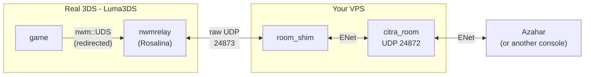

# CTRelay - remote local-wireless for the Nintendo 3DS

Play a 3DS **local wireless** (`nwm::UDS`) game with someone who isn't in the
room. A real 3DS running Luma3DS joins a session hosted by an Azahar instance
(or another console) somewhere else on the internet - the traffic is relayed
through a small self-hosted server.

The console never knows. As far as the game is concerned it is talking to a
nearby machine over ad-hoc Wi-Fi.

> **Status:** basic UDS sessions work end to end (e.g. Yo-kai Watch, host on
> Azahar + join on a real 3DS). Download Play titles (Mario Kart 7, ...) are
> **not** supported yet - see [Limitations](#limitations).

> **Games:** bring your own, dumped from cartridges/titles you own. Nothing in
> this repository contains or distributes game content.

---

## How it works

There are three moving parts. Two run on a server you control; one is a patch
to Luma3DS on the console.



1. **citra_room** (`citra-room/`) - Azahar's dedicated multiplayer server. It's
   the meeting point: every peer, plus our shim, connects to it over ENet/UDP
   (default port **24872**). This is "Lot 1".

2. **room_shim** (`shim/`) - runs on the same server, joins the room as a normal
   member, and *impersonates the console's wireless stack*: it receives the
   host's beacon, performs the UDS association handshake (Authentication ->
   Association Response -> EAPoL), and translates every packet between the room's
   `WifiPacket` format and a tiny UDP protocol spoken by the relay (port
   **24873**).

3. **nwmrelay** (`luma3ds-relay/`) - the console side ("Lot 2"). A small kernel
   patch in Luma3DS redirects the game's `nwm::UDS` service to a stand-in called
   `nwmrelay`, living in the Rosalina sysmodule. The relay answers the UDS calls
   locally (pretending to be the NWM module) and bridges the real traffic to the
   shim over the internet. Because entering "local play" drops the Wi-Fi, the
   relay also re-enables an infrastructure connection so it can reach the VPS.

**Data path:** `game -> nwm::UDS (redirected) -> nwmrelay -> UDP -> shim -> ENet room
-> peer`, and symmetrically back. See [How the code is laid out](#how-the-code-is-laid-out)
for a per-file description.

---

## What you need

**A server (VPS)** with a public IP and an open UDP port - Debian/Ubuntu, Docker
installed. Modest specs are fine to *run* it.

**A build machine** to compile the room image (heavy C++ build): Docker + git,
ideally >= 8 GB RAM and ~15 GB free disk. Can be the same box if it's beefy
enough, but a small VPS will OOM - build elsewhere and push.

**A 3DS** with Luma3DS-based CFW (boot9strap), and the ability to replace its
`boot.firm`. Plus the Luma3DS build toolchain: **devkitARM** (devkitPro `3ds-dev`)
and **firmtool** (`pip3 install firmtool`).

**Your own games**, dumped from titles you own.

---

## Step by step

### 1 - Stand up the citra_room server

On the **build machine** (from this repo):

```bash
cd citra-room
./build-image.sh              # auto-clones azahar, builds azahar-room:latest (long!)
# low-RAM box: cap parallel jobs -> ./build-image.sh --jobs 2

cp .env.example .env          # set ROOM_NAME and PREFERRED_APP at least
./push-to-vps.sh user@vps-host        # add the ssh port as a 3rd-ish arg if not 22
```

`push-to-vps.sh` streams the image over SSH, then runs `deploy.sh` on the VPS:
it installs a systemd service and opens the room's UDP port (24872) with `ufw`.

Full server reference (all `.env` variables, manual install, operations):
[`citra-room/README.txt`](citra-room/README.txt).

### 2 - Build and run the shim (on the VPS)

```bash
sudo apt install -y g++ libenet-dev        # ENet 1.3.x
# copy shim/room_shim.cpp to the VPS, then:
g++ -O2 -o room_shim room_shim.cpp -lenet

# open the relay <-> shim port (deploy.sh only opened the room's 24872):
sudo ufw allow 24873/udp

# run it. args: [roomHost] [roomPort] [nick] [udpPort]
./room_shim 127.0.0.1 24872 relayshim-$RANDOM 24873
```

The shim runs on the same box as the room, so `roomHost` is `127.0.0.1`. Give it
a **unique nick** each time - the room rejects duplicate names. It prints
`UDP listening on 0.0.0.0:24873` and `connecting to room ...`; leave it running.

> Tip: run it under `tmux`/`screen` (or make it a systemd service) so it
> survives your SSH session.

### 3 - Build Luma3DS with the relay

Start from a Luma3DS checkout that carries these changes - either the fork that
bundles them, or a fresh clone of Luma3DS with the files from `luma3ds-relay/`
dropped in and the edits from
[`luma3ds-relay/INTEGRATION.txt`](luma3ds-relay/INTEGRATION.txt) applied.

Before building, set your server address:

```bash
cd sysmodules/rosalina/include
cp vps_config.h.example vps_config.h
# edit vps_config.h: VPS_IP_A..D = your VPS public IP, VPS_PORT = 24873
```

Then build and install:

```bash
make                 # produces boot.firm
# copy boot.firm to the root of the console's SD card, then reboot the 3DS
```

`vps_config.h` is gitignored, so your address never lands in the repo.

### 4 - Play

1. **Console:** open the Rosalina menu (**L + Down + Select** by default) ->
   **Local Wi-Fi relay** -> **Enable / disable relay** -> turn it **ON**.
2. **Peer (Azahar):** *Multiplayer -> Join Room*, then fill in the server IP, the
   port (`24872`), a nickname, and the password if the room has one. Once in the
   room, start the game's **local multiplayer** as the host.
3. **Console:** launch the *same game*, go into its local multiplayer, and
   **search** - the host's session appears; join it.
4. Play. Use **Local Wi-Fi relay -> Connection diagnostic** to watch the link
   (see below).

When you're done, turning the relay **OFF** (or exiting the game) resets the
session cleanly, so you can rejoin without rebooting the console.

---

## Diagnostics

**Local Wi-Fi relay -> Connection diagnostic** shows:

| Field | Meaning |
|-------|---------|
| `state` | network thread: `1` = running/bridged, `10-13` = bringing Wi-Fi/socket up, negative = error |
| `status` | UDS status: `3` idle, `6` hosting, `9` joined as client |
| `joined` | `1` once the shim has associated us to the host |
| `node` | our node id in the session |
| `sent` / `received` | UDP packets to / from the shim |
| `hostData` | data frames received from the host |
| `console IP` | the console's own LAN IP (sanity check that Wi-Fi came up) |
| `RTT to VPS` | round-trip to the shim, from the heartbeat |
| `beacon cached` | bytes of the last relayed beacon (`0` = no session seen yet) |

**"Connection lost" when joining?** Check, in order: the shim is running and
printing traffic; UDP **24873** is open on the VPS; the peer is actually hosting;
both sides are on the *same game*; `RTT to VPS` is sane (the relay reaches the
VPS at all).

---

## How the code is laid out

```
citra-room/          Deployable citra_room server (Docker + systemd). Lot 1.
  build-image.sh       builds azahar-room:latest from azahar source
  push-to-vps.sh       ships the image to the VPS and runs deploy.sh
  deploy.sh            installs the systemd service, opens the room UDP port
  .env.example         room config (name, port, max players, password)

shim/
  room_shim.cpp        The bridge. Joins the room, drives the UDS association
                       handshake, and (de)serializes WifiPackets <-> the relay's
                       UDP frames. The frame formats are documented at the top
                       of the file.

luma3ds-relay/         The 3DS side. Lot 2.
  INTEGRATION.txt        exact edits to make in a Luma3DS checkout (k11 redirect,
                         service registration, startup + shutdown hooks)
  rosalina/
    nwm_relay.c          The relay: a software nwm::UDS server. Answers the
                         game's UDS commands (Bind, ConnectToNetwork, SendTo,
                         PullPacket, ...) and runs a network thread that bridges
                         traffic to the shim. Also re-enables Wi-Fi for local play.
    nwm_relay_menu.c     Rosalina menu: enable/disable + diagnostics.
    vps_config.h.example your server's address (copy to vps_config.h)
```

The relay<->shim UDP protocol (`NWMB/NWMJ/NWMC/NWMX/NWMD/NWMP/NWMR`) is described
in comments at the top of both [`shim/room_shim.cpp`](shim/room_shim.cpp) and
[`luma3ds-relay/rosalina/nwm_relay.c`](luma3ds-relay/rosalina/nwm_relay.c).

---

## Limitations

- **Download Play (DLP)** - Mario Kart 7 and other "download play" titles don't
  work. DLP relies on the real NWM module to set up its CCMP encryption keys,
  which the relay doesn't reproduce; redirecting `nwm::UDS` breaks that path.
  Regular UDS local-play sessions are unaffected.
- **Two nodes** - verified with one host + one joining console. More nodes aren't
  tested.
- **Latency** - depends on the geography between console, VPS, and peer, and on
  the peer. Azahar sends every wireless packet *reliably* over ENet, so a shaky
  link to the peer shows up as lag; a desktop Azahar on a good connection is
  smoother.

**Azahar compatibility.** The shim and relay target azahar netplay
`network_version = 4` (verified on Azahar `2126.0-rc4`/`rc5`; the room server
built from either works with both). If a future Azahar bumps that constant, the
room, the shim, and the relay all have to match: rebuild the room from that
source and update the version sent in `shim/room_shim.cpp` and the JoinRequest.

---

## License

Copyright (C) 2026 CTRelay contributors. Licensed under **GPLv3** - see
[LICENSE](LICENSE). The parts that modify or link Luma3DS are derivative works
of Luma3DS and remain under its GPLv3 terms.
